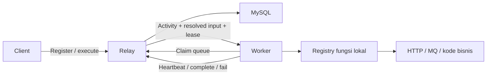

# Relay — Distributed Workflow & Task Orchestration

Relay mengatur DAG workflow, conditional step, retry, Saga compensation, dan lease worker melalui Go dan MySQL. External worker menjalankan seluruh pekerjaan bisnis. Engine hanya mengetahui **queue, nama activity, dan input**; implementasi HTTP, message broker, atau fungsi lokal menjadi tanggung jawab worker.



## Setup dan pengujian

Gunakan Go sesuai `go.mod`, Node untuk frontend, dan MySQL 8.4. Salin `.env.example` menjadi `.env`, sesuaikan koneksi database serta credentials worker, lalu buat **database kosong** sebelum menjalankan:

```sh
go run ./cmd/migrate
go run .
```

Dashboard dan API tersedia di `http://localhost:8000`. Startup server tidak menerapkan schema otomatis. `migrations/000001_init_schema.up.sql` adalah satu baseline yang langsung membuat enam tabel final; pasangan down menghapus tabel tersebut. Database dari schema lain harus dibuat ulang, tanpa konversi data. CLI migration mencatat baseline yang sudah diterapkan pada tabel metadata `schema_migrations`.

Frontend:

```sh
cd web
npm ci
npm run build
```

Vite menulis asset ke `internal/web/dist` untuk di-embed oleh Go. Dockerfile membangun frontend dan backend dalam image yang sama.

Validasi backend:

```sh
go vet ./...
go test -race -timeout 5m ./...
```

Untuk menjalankan integration test, set `TEST_DB_DSN` ke **server MySQL khusus test**. Akun test memerlukan izin CREATE/DROP DATABASE. Setiap test membuat schema `relay_test_<uuid>`, menerapkan baseline, dan menghapus hanya schema tersebut. Tanpa DSN, integration test dilewati; koneksi/migration gagal pada DSN yang diatur akan menggagalkan test. Test baseline juga menjalankan down → up.

Konfigurasi backend:

| Key | Default | Fungsi |
| --- | --- | --- |
| `PORT` | `8000` | Port HTTP |
| `DB_HOST`, `DB_PORT`, `DB_USER`, `DB_PASSWORD`, `DB_NAME` | Lihat `.env.example` | Koneksi MySQL |
| `DEFAULT_TIMEOUT` | `15s` | Timeout attempt jika step tidak menentukan timeout |
| `DEFAULT_LEASE_DURATION` | `30s` | Batas durasi lease; tetap dibatasi deadline attempt |
| `DEFAULT_HEARTBEAT_INTERVAL` | `10s` | Rekomendasi interval heartbeat worker |
| `REAPER_INTERVAL` | `5s` | Interval recovery lease kedaluwarsa |
| `WORKER_LONG_POLL_TIMEOUT` | `25s` | Maksimum waktu tunggu claim |
| `MAX_PAYLOAD_SIZE` | `5` | Batas request dalam MB |
| `CONCURRENT_RETRY_LIMIT` | `3` | Batas retry konflik saat register versi workflow |
| `CONDITION_MAX_DEPTH`, `CONDITION_MAX_NODES` | `8`, `64` | Batas condition tree |
| `RELAY_WORKER_API_ENABLED` | `false` | Mengaktifkan worker API |
| `RELAY_WORKER_CREDENTIALS` | Tidak ada | Array credentials service dengan `id`, `token`, dan `queues` |

Saat worker API diaktifkan, credentials wajib tersedia. Setiap service memiliki token dan izin queue; `queues: ["*"]` memberikan akses semua queue. Simpan token di environment deployment.

## Definisi workflow

`POST /workflows` menerima JSON berikut:

```json
{
  "name": "orders.checkout",
  "context": { "currency": "IDR" },
  "steps": [
    {
      "id": "reserve",
      "name": "Reserve inventory",
      "queue": "orders",
      "activity": "inventory.reserve",
      "input": { "order_id": "{{context.order_id}}" },
      "timeout": 30,
      "retry": { "max_attempts": 3, "backoff": 2, "multiplier": 2, "max_backoff": 60 },
      "compensation": {
        "queue": "orders",
        "activity": "inventory.release",
        "input": { "reservation_id": "{{this.output.reservation_id}}" },
        "timeout": 30
      }
    },
    {
      "id": "charge",
      "queue": "payments",
      "activity": "payment.charge",
      "depends_on": ["reserve"],
      "input": { "order_id": "{{context.order_id}}" }
    }
  ]
}
```

Response `201` berisi workflow beserta ID, versi, context, steps, dan timestamps. Definisi identik dengan versi terbaru dikembalikan kembali; perubahan definisi membuat versi berikutnya. `version` opsional untuk registrasi awal, default `1`.

| Field step | Ketentuan |
| --- | --- |
| `id` | Wajib, unik dalam workflow |
| `queue` | Wajib, literal `[A-Za-z0-9._-]`, panjang 1–128 |
| `activity` | Wajib, aturan identifier sama; nama fungsi yang didefinisikan worker |
| `input` | JSON apa pun; jika tidak diisi menjadi `{}`; JSON `null` tetap `null` |
| `depends_on` | ID prerequisite; harus ada, tanpa self-dependency atau cycle |
| `when` | Condition tree opsional sebelum claim |
| `timeout` | Detik, tidak negatif; `0` memakai default backend |
| `retry` | Opsional; tanpa retry maksimum satu attempt |
| `compensation` | Queue, activity, input; timeout/retry opsional |
| `irreversible` | Default false; jika true, compensation tidak boleh ada |
| `name` | Label opsional pada dashboard |

Queue dan activity tidak boleh memakai template. Isi input menjadi kontrak worker; engine tidak menafsirkan URL, method HTTP, atau exchange broker. Setiap worker pada queue yang sama wajib mendukung semua activity normal dan kompensasi milik queue tersebut.

Retry menghitung attempt pertama dalam `max_attempts`. `backoff` dan `max_backoff` menggunakan detik. Jeda retry adalah `backoff * multiplier^(attempt-1)`, dibatasi `max_backoff` jika diisi dan batas internal satu tahun. Multiplier yang tidak diisi memakai `1`.

### Input dan output

Engine menyimpan snapshot template input saat execute. Saat claim, input di-resolve dari context terkini dan output yang tersedia:

- `{{context.order_id}}` atau `{{order_id}}`: nilai context execution.
- `{{steps.reserve.output.reservation_id}}`: output step normal.
- `{{steps.reserve.output.items.0.id}}`: elemen array output.
- `{{this.output.reservation_id}}`: output asli step yang sedang dikompensasi.
- `{{steps.reserve.compensation.output}}`: output kompensasi.

Placeholder object/array yang mengisi seluruh string akan menjadi JSON object/array. Placeholder yang tidak ditemukan tetap berupa template. Kirim identifier numerik besar sebagai string jika worker menggunakan JavaScript.

Database serta detail execution **selalu menyimpan template input asli**. Claim mengirim hasil resolve melalui `input`; payload hasil resolve tidak disimpan sebagai riwayat. Retry melakukan resolve ulang dari template asli. Timeout efektif dibekukan saat execute sehingga perubahan default backend tidak mengubah timeout execution yang sudah dibuat.

### Condition dan kompensasi

Contoh condition:

```json
{
  "all": [
    { "ref": "steps.reserve.output.available", "op": "eq", "value": true },
    { "ref": "currency", "op": "in", "value": ["IDR", "USD"] }
  ]
}
```

Gunakan `all` atau `any` untuk group, dan `ref`/`op`/`value` untuk leaf. Operator: `eq`, `ne`, `exists`, `gt`, `gte`, `lt`, `lte`, `in`. `exists` tidak membutuhkan value. Reference output harus memakai `steps.<id>.output...` dan menunjuk ancestor dalam DAG. Reference context membaca path context secara langsung.

Condition false menghasilkan `SKIPPED` dengan attempt nol, tanpa lease. Dependency pada step skipped tetap terpenuhi. Path hilang pada operator selain `exists` menghasilkan kegagalan evaluasi. Audit tersedia pada `condition_evaluation`.

Jika step gagal setelah retry habis atau menerima fail nonretryable, step normal yang belum berjalan dibatalkan. Step yang sudah berhasil dikompensasi dengan urutan dependency terbalik. Sibling yang masih running diberi kesempatan selesai; kompensasinya menunggu. Engine menurunkan urutan rollback dari DAG normal, termasuk jalur melalui step tanpa kompensasi.

## Execute dan query

```http
POST /workflows/orders.checkout/execute
Content-Type: application/json
Idempotency-Key: checkout:ORD-1

{"workflow_version":1,"context":{"order_id":"ORD-1"}}
```

`workflow_version` opsional dan memilih versi terbaru jika tidak diisi. Versi eksplisit wajib integer positif. Context request meng-override context bawaan secara shallow. Request kosong, `null`, `{}`, atau context null memakai context request kosong.

Response `201`:

```json
{
  "id": "execution-uuid",
  "workflow_id": "definition-uuid",
  "status": "RUNNING",
  "context": { "currency": "IDR", "order_id": "ORD-1" },
  "total_steps": 3,
  "created_at": "2026-11-18T03:00:00Z"
}
```

`total_steps` menyertakan tiket kompensasi. Header `Idempotency-Replayed` bernilai `false` untuk execution baru, `true` untuk replay. Key wajib 1–128 byte ASCII printable tanpa whitespace dan berlaku per nama workflow lintas versi. Key + context sama mengembalikan receipt awal. Context atau target versi eksplisit berbeda menghasilkan `409`. Field request yang tidak dikenal ditolak `400`.

| Method | Endpoint | Hasil |
| --- | --- | --- |
| GET | `/workflows` | Ringkasan versi terbaru tiap nama |
| GET | `/workflows/{name}` | Definisi terbaru |
| GET | `/workflows/{name}/versions` | Ringkasan versi |
| GET | `/workflows/{name}/versions/{version}` | Definisi versi tertentu |
| GET | `/workflows/{name}/versions/{version}/changes` | Perubahan dibanding versi sebelumnya |
| GET | `/executions` | Riwayat execution |
| GET | `/executions/{id}` | Detail execution, template input, output, dan attempts |
| GET | `/health` | Health endpoint |
| GET | `/system/metrics` | Metrik proses/server untuk dashboard |

List mendukung `limit` dan `offset`; default limit `50`, maksimum `100`. Workflow dipilih berdasarkan **nama**, bukan UUID; detail execution memakai UUID ticket.

## Protokol external worker

Seluruh endpoint worker memerlukan `Authorization: Bearer <token>` dan `Content-Type: application/json`.

### Claim

```http
POST /worker/tasks/claim

{"worker_id":"orders-01","queue":"orders","wait_timeout_ms":25000}
```

Worker hanya memilih queue. Jika tidak ada task, server mencoba kembali setiap 500–700 ms dengan jitter sampai budget tunggu habis. `wait_timeout_ms` tidak diisi memakai min(25 detik, batas konfigurasi); `0` berarti satu percobaan. Nilai negatif atau di atas batas ditolak `400`.

Response `200`:

```json
{
  "task_id": "step-execution-uuid",
  "workflow_execution_id": "execution-uuid",
  "step_id": "reserve",
  "queue": "orders",
  "activity": "inventory.reserve",
  "input": { "order_id": "ORD-1" },
  "attempt": 1,
  "is_compensation": false,
  "timeout_seconds": 30,
  "deadline": "2026-11-18T03:00:30Z",
  "heartbeat_interval_ms": 10000,
  "lease_token": "illustrative-token",
  "lease_expires_at": "2026-11-18T03:00:30Z",
  "lease_duration_ms": 30000
}
```

Response `204` tidak memiliki body. Jangan mencoba parse JSON untuk response tersebut. Gunakan `task_id` untuk endpoint task dan simpan lease token hanya selama attempt terkait.

### Heartbeat

```http
POST /worker/tasks/step-execution-uuid/heartbeat

{"worker_id":"orders-01","lease_token":"illustrative-token","lease_duration_ms":10000}
```

Response `200` berisi `lease_expires_at` dan `lease_duration_ms`. Worker dapat meminta durasi lebih pendek; durasi tidak dapat melebihi batas backend dan expiry tidak pernah melewati deadline attempt. Hentikan pekerjaan jika ownership/lease hilang.

### Complete dan fail

```http
POST /worker/tasks/step-execution-uuid/complete

{"worker_id":"orders-01","lease_token":"illustrative-token","output":{"reservation_id":"RSV-1"}}
```

```http
POST /worker/tasks/step-execution-uuid/fail

{"worker_id":"orders-01","lease_token":"illustrative-token","error":{"message":"inventory unavailable","retryable":false}}
```

Keduanya mengembalikan `200` dengan `{"accepted":true}`. Output kosong atau null dinormalisasi menjadi `{}`. Fail memakai `retryable: true` jika tidak diisi.

Report identik pada attempt yang sudah dilaporkan diterima kembali, termasuk ketika attempt berikutnya sudah dimulai. Report berbeda untuk hasil yang sama menghasilkan konflik. Worker harus membekukan body report dan mengulang body yang sama jika response jaringan tidak pasti.

| Status / code | Arti |
| --- | --- |
| `400 BAD_REQUEST` | Worker/queue/input request tidak valid, field tidak dikenal, atau waktu tunggu tidak valid |
| `401 UNAUTHORIZED` | Credentials service salah/tidak tersedia |
| `401 INVALID_LEASE_TOKEN` | Token attempt tidak valid |
| `403 WORKER_API_DISABLED` | Worker API tidak aktif |
| `403 FORBIDDEN_QUEUE` / `FORBIDDEN_TASK` | Izin queue atau pemilik service berbeda |
| `404 NOT_FOUND` | Task tidak ditemukan |
| `409 LOCK_LOST` | Ownership, deadline, atau lease tidak lagi aktif |
| `409 REPORT_CONFLICT` | Isi report bertentangan dengan report sebelumnya |
| `413 PAYLOAD_TOO_LARGE` | Request melebihi batas |

### Registry dan lifecycle worker

Activity adalah nama fungsi yang dipahami worker. Contoh pemetaan:

```typescript
type Json = null | boolean | number | string | Json[] | { [key: string]: Json };
type TaskContext = {
  taskId: string;
  workflowExecutionId: string;
  stepId: string;
  attempt: number;
  isCompensation: boolean;
  signal: AbortSignal;
};
type Handler = (input: Json, context: TaskContext) => Promise<Json>;
type Registry = Record<string, Handler>;
```

Handler `inventory.reserve` bisa memanggil HTTP; `inventory.release` bisa menjalankan transaksi database; handler lain bisa publish message. Pilihan tersebut hanya berada di repository worker. Jangan membuat registry engine atau mengirim daftar implementasi dalam claim.

Lifecycle per slot concurrency:

1. Claim queue saat slot tersedia; pada `204`, ulangi long poll.
2. Lookup `registry[task.activity]`. Jika tidak tersedia, laporkan fail `retryable: false` dengan pesan activity tidak dikenal dan perbaiki deployment worker.
3. Jalankan handler dengan `task.input`, awasi deadline, dan kirim heartbeat tanpa overlap selama pekerjaan berjalan.
4. Bekukan hasil complete/fail, lalu kirim ulang report yang sama jika response belum pasti.
5. Hentikan heartbeat setelah report diterima atau lease hilang; batalkan operasi handler melalui signal jika memungkinkan.

Semua worker pada queue yang sama harus menyediakan registry yang sama, termasuk handler kompensasi. Gunakan queue berbeda untuk kelompok worker dengan kemampuan berbeda.

Lease expiry dapat menyebabkan efek bisnis dijalankan ulang setelah crash. Gunakan `task_id` sebagai dasar idempotency key bisnis lintas attempt; jangan memasukkan nomor attempt. Kompensasi memiliki task ID sendiri. Engine menyediakan orchestration dan fencing report, sedangkan deduplikasi efek eksternal menjadi tanggung jawab handler/downstream.

## Penyimpanan dan status

Enam tabel aplikasi: `workflow_definitions`, `step_definitions`, `workflow_executions`, `step_executions`, `workflow_execution_requests`, dan `step_execution_attempts`.

Status workflow: `RUNNING`, `COMPLETED`, `FAILED`, `COMPENSATING`, `COMPENSATED`, `COMPENSATION_FAILED`. Step juga memakai `WAITING`, `PENDING`, `RUNNING`, `COMPLETED`, `SKIPPED`, `CANCELLED`, `FAILED`, `COMPENSATED`, `COMPENSATION_FAILED`. Attempt history membedakan `RUNNING`, `COMPLETED`, `FAILED`, `TIMED_OUT`, dan `ABANDONED`.

Claim memakai `FOR UPDATE SKIP LOCKED`. Claim, report, dan recovery mengambil lock workflow lebih dahulu agar perubahan lifecycle konsisten. Reaper menutup attempt yang kedaluwarsa dan menerapkan retry/rollback. Detail execution menyertakan identitas service/worker, timestamps, outcome, dan error attempt; lease token/hash tidak diekspos.
