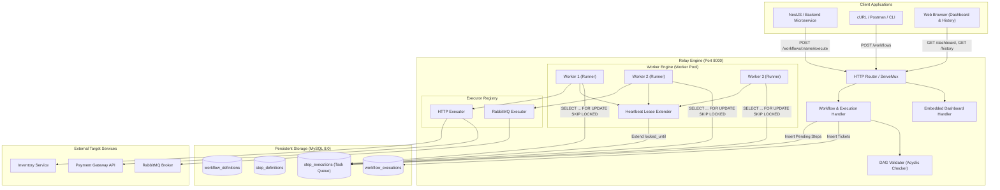
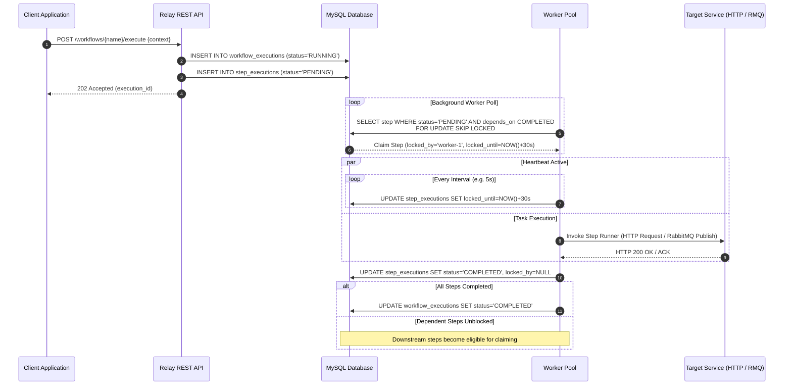
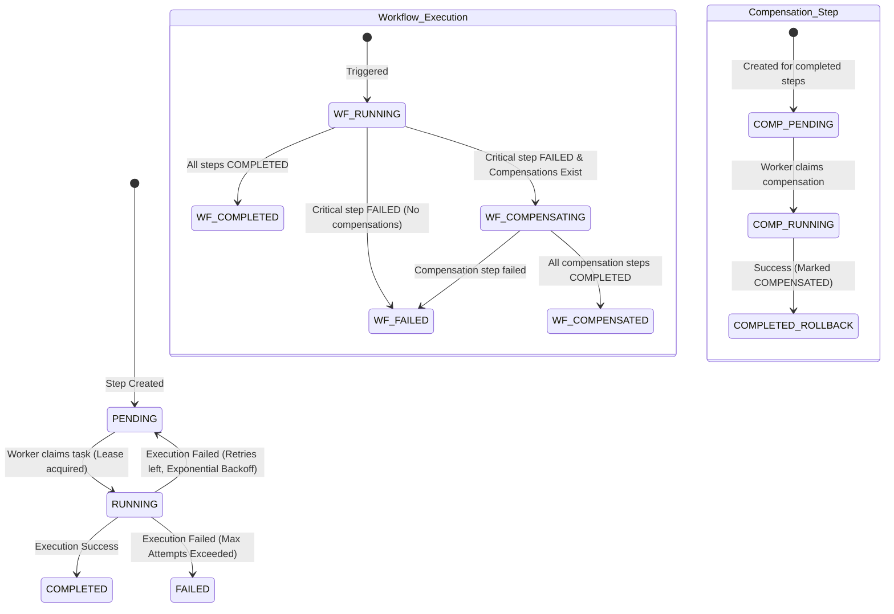

# Relay • Distributed Workflow & Task Orchestration Engine

Relay adalah distributed workflow engine dan task orchestrator berkinerja tinggi berbasis Go dan MySQL. Relay dirancang untuk mengeksekusi Directed Acyclic Graph (DAG) workflows dengan dukungan Saga pattern (kompensasi otomatis saat gagal), exponential retry backoff, distributed task locking (`SELECT ... FOR UPDATE SKIP LOCKED`), lease heartbeat, dan web observability dashboard.

> **Catatan:** Server Relay diasumsikan berjalan pada host lokal di port `8000` (`http://localhost:8000`).

---

## Pengujian backend

Jalankan `go vet ./...` dan `go test -race -timeout 5m ./...`.
Untuk menyertakan tes integrasi, set `TEST_DB_DSN` ke server **MySQL 8.4 khusus tes**
(contoh `root:test_password@tcp(127.0.0.1:3306)/?parseTime=true&clientFoundRows=true`).
Akun tersebut memerlukan izin CREATE/DROP DATABASE. Setiap tes membuat schema
`relay_test_<uuid>`, menerapkan seluruh migrasi `.up.sql` secara berurutan, lalu
menghapus hanya schema tersebut. Tanpa DSN tes integrasi dilewati; jika DSN sudah
diatur, koneksi atau migrasi yang gagal membuat tes gagal. Job CI `integration`
menyediakan server tersebut dan menjalankan tes dengan race detector.

## Daftar Isi

1. [Workflow & Step Definition Guide](#1-workflow--step-definition-guide)
   - [1.1 Struktur Workflow Definition](#11-struktur-workflow-definition)
   - [1.2 Struktur Step Definition](#12-struktur-step-definition)
   - [1.3 Konfigurasi Tipe Runner (HTTP & RabbitMQ)](#13-konfigurasi-tipe-runner-http--rabbitmq)
   - [1.4 Dynamic Context & Parameter Interpolation](#14-dynamic-context--parameter-interpolation-data-dinamis-user)
   - [1.5 Aturan Validasi DAG](#15-aturan-validasi-dag)
   - [1.6 Saga Pattern & Definisi Kompensasi](#16-saga-pattern--definisi-kompensasi)
   - [1.7 Contoh Lengkap Workflow Definition (E-Commerce Saga)](#17-contoh-lengkap-workflow-definition-e-commerce-saga)
   - [1.8 Conditional Step Execution (when)](#18-conditional-step-execution-when)
2. [Workflow Calling Guide](#2-workflow-calling-guide)
   - [2.1 Ringkasan REST API Endpoints](#21-ringkasan-rest-api-endpoints)
   - [2.2 Mendaftarkan Workflow Baru (`POST /workflows`)](#22-mendaftarkan-workflow-baru-post-workflows)
   - [2.3 Menjalankan Workflow (`POST /workflows/{name}/execute`)](#23-menjalankan-workflow-post-workflowsnameexecute)
   - [2.4 Memeriksa Status Eksekusi (`GET /executions/{id}`)](#24-memeriksa-status-eksekusi-get-executionsid)
   - [2.5 Contoh Integrasi Client (cURL, TypeScript/NestJS, Go)](#25-contoh-integrasi-client)
3. [Mekanisme Arsitektur Relay & Diagram Pendukung](#3-mekanisme-arsitektur-relay--diagram-pendukung)
   - [3.1 Arsitektur Sistem & Komponen Inti](#31-arsitektur-sistem--komponen-inti)
   - [3.2 Diagram Arsitektur Keseluruhan](#32-diagram-arsitektur-keseluruhan)
   - [3.3 Diagram Alur Eksekusi & Siklus Hidup Worker](#33-diagram-alur-eksekusi--siklus-hidup-worker)
   - [3.4 Diagram State Machine (Workflow & Step Lifecycle)](#34-diagram-state-machine-workflow--step-lifecycle)
   - [3.5 Detail Mekanisme Kunci Engine](#35-detail-mekanisme-kunci-engine)

---

## 1. Workflow & Step Definition Guide

Workflow di Relay mendefinisikan sebuah grafik alur kerja terarah (DAG) yang terdiri atas satu atau lebih **Step**.

### 1.1 Struktur Workflow Definition

| Field | Tipe | Wajib | Deskripsi |
| :--- | :--- | :--- | :--- |
| `name` | `string` | **Ya** | Nama pengenal alur kerja (contoh: `order.checkout_saga_v1`). |
| `version` | `int` | **Ya** | Nomor versi integer (kombinasi `name` + `version` bersifat unik di database). |
| `context` | `object` | Tidak | Metadata atau initial state bawaan workflow dalam format JSON. |
| `steps` | `array` | **Ya** | Daftar step/node yang menyusun alur kerja (minimal 1 step). |

### 1.2 Struktur Step Definition

Setiap elemen dalam array `steps` memiliki spesifikasi sebagai berikut:

| Field | Tipe | Wajib | Default | Deskripsi |
| :--- | :--- | :--- | :--- | :--- |
| `id` | `string` | **Ya** | - | Pengenal unik step di dalam workflow (contoh: `step-charge-card`). |
| `name` | `string` | Tidak | - | Nama deskriptif untuk ditampilkan di log/dashboard. |
| `type` | `string` | **Ya** | - | Tipe runner eksekutor: `"http"` atau `"message"`. |
| `config` | `object` | **Ya** | - | Konfigurasi spesifik runner sesuai tipe yang dipilih (lihat Bagian 1.3). |
| `depends_on` | `string[]` | Tidak | `[]` | ID step lain yang harus selesai berstatus `COMPLETED` atau `SKIPPED` sebelum step ini dijalankan. Jika kosong, step dapat langsung dijalankan saat workflow dimulai. |
| `when` | `object` | Tidak | `null` | Kondisi opsional sebelum step dieksekusi. Jika bernilai `false`, step berstatus `SKIPPED` dan step downstream tetap berjalan (lihat Bagian 1.8). |
| `timeout` | `int` | Tidak | `0` (unlimited) | Batas waktu eksekusi step dalam detik. |
| `retry` | `object` | Tidak | `null` | Kebijakan percobaan ulang jika step mengalami error eksekusi. |
| `compensation`| `object` | Tidak | `null` | Definisi aksi rollback jika workflow gagal di step downstream (Saga pattern). |
| `irreversible`| `boolean`| Tidak | `false` | Menandai bahwa step tidak dapat di-rollback. Jika `true`, `compensation` dilarang diset. |

#### Struktur Object `retry`
```json
{
  "max_attempts": 3,
  "backoff": 2,
  "multiplier": 2.0,
  "max_backoff": 60
}
```
- `max_attempts` (*int*): Jumlah maksimal eksekusi percobaan (termasuk attempt pertama).
- `backoff` (*int*): Delay awal sebelum retry berikutnya (dalam detik).
- `multiplier` (*float*): Faktor pengali interval retry (exponential backoff). Formula: `backoff * (multiplier ^ (attempt - 1))`.
- `max_backoff` (*int*): Batas maksimum jeda retry (dalam detik).

#### Struktur Object `compensation`
```json
{
  "type": "http",
  "config": {
    "method": "POST",
    "url": "https://payment.internal/refund",
    "body": { "reason": "saga_rollback" }
  },
  "timeout": 15,
  "retry": {
    "max_attempts": 3,
    "backoff": 1
  }
}
```

---

### 1.3 Konfigurasi Tipe Runner (HTTP & RabbitMQ)

#### Tipe 1: HTTP Step (`type: "http"`)
Digunakan untuk memanggil REST API atau web service eksternal.

```json
{
  "id": "step-charge-card",
  "name": "Charge Credit Card",
  "type": "http",
  "config": {
    "method": "POST",
    "url": "https://api.payment.com/v1/charge",
    "headers": {
      "Authorization": "Bearer sec_test_xyz",
      "Content-Type": "application/json"
    },
    "body": {
      "amount": 150000,
      "currency": "IDR"
    }
  }
}
```

#### Tipe 2: RabbitMQ Message Step (`type: "message"`)
Digunakan untuk menerbitkan event asinkron ke antrean/exchange message broker RabbitMQ.

```json
{
  "id": "step-notify-warehouse",
  "name": "Notify Warehouse System",
  "type": "message",
  "config": {
    "exchange": "logistics_topic",
    "routing_key": "warehouse.orders.prepare",
    "content_type": "application/json",
    "headers": {
      "x-priority": 1
    },
    "payload": {
      "order_id": "ORD-99812",
      "sku": "VCR-50K",
      "quantity": 1
    }
  }
}
```

---

### 1.4 Dynamic Context & Parameter Interpolation (Data Dinamis User)

Dalam sistem orkestrator seperti Relay, **Workflow Definition adalah Template (Blueprint)**. Kita **tidak pernah meng-hardcode** data transaksi dinamis (seperti `cart_id`, `user_id`, atau `amount`) di dalam definisi alur.

Sebagai gantinya, gunakan placeholder template:
- `{{context.field}}` atau `{{field}}`
- `{{context.nested.field}}`

#### Contoh Step Definition dengan Parameter Dinamis:
```json
{
  "id": "validate-cart",
  "name": "Validate Cart Items",
  "type": "http",
  "config": {
    "method": "POST",
    "url": "http://cart-service.internal/carts/{{context.cart_id}}/validate",
    "headers": {
      "X-User-ID": "{{context.user_id}}",
      "Content-Type": "application/json"
    },
    "body": {
      "cart_id": "{{context.cart_id}}",
      "user_id": "{{context.user_id}}",
      "payment_channel": "{{context.payment_channel}}"
    }
  },
  "timeout": 5
}
```

#### Cara Client Mengisi Data Dinamis Saat Runtime:
Saat client (misal NestJS Checkout Service) men-trigger eksekusi alur, sertakan object `context`:
```http
POST http://localhost:8000/workflows/ecommerce.checkout_saga/execute
Content-Type: application/json

{
  "context": {
    "cart_id": "CART-USER-9921",
    "user_id": "USR-10882",
    "payment_channel": "BCA_VA"
  }
}
```
Relay secara otomatis me-resolve dan menggantikan seluruh placeholder `{{context.cart_id}}` dan `{{context.user_id}}` di dalam URL, headers, dan body sebelum dieksekusi oleh worker!

---

### 1.5 Aturan Validasi DAG

Relay melakukan validasi integritas struktur grafik sebelum workflow disimpan ke database:
1. **Acyclic Check**: Tidak boleh ada dependency melingkar (*cyclic dependency*), baik langsung (`A -> B -> A`) maupun tidak langsung (`A -> B -> C -> A`).
2. **No Self-Dependency**: Step tidak boleh bergantung pada dirinya sendiri (`depends_on: ["self"]`).
3. **Missing Dependency Detection**: Step tidak boleh mencantumkan `depends_on` ID yang tidak terdaftar di dalam array `steps`.
4. **Unique Step ID**: Setiap step dalam satu workflow wajib memiliki `id` yang unik.
5. **Config Schema**: Field `config` harus sesuai dengan tipe eksekutor (misal: HTTP wajib memiliki `method` dan URL valid; RabbitMQ wajib memiliki `exchange` atau `routing_key`).
6. **Irreversible vs Compensation**: Jika `irreversible: true`, step **dilarang** memiliki `compensation`.
7. **Condition Tree & Anchor Validation (`when`)**: Jika step mendefinisikan kondisi `when`, pohon kondisi divalidasi tidak melebihi batas `CONDITION_MAX_DEPTH` dan `CONDITION_MAX_NODES`. Anchor output (`steps.<id>.output...`) wajib merujuk ke step ancestor dalam DAG, dan anchor context dilarang bertabrakan dengan ID root step apa pun.

---

### 1.6 Saga Pattern & Definisi Kompensasi

Jika sebuah alur transaksi bisnis lintas-service mengalami kegagalan pada step di tengah jalan, Relay akan menjalankan mekanisme **Saga Compensation**:
- Hanya step-step yang **telah berhasil (`COMPLETED`)** sebelum terjadinya kegagalan yang akan dieksekusi kompensasinya.
- Step kompensasi dieksekusi dengan prioritas darurat (`is_compensation = TRUE`).
- Step downstream yang belum sempat dijalankan akan otomatis dialihkan ke status `CANCELLED`.
- Jika seluruh step kompensasi sukses, status workflow ditutup sebagai `COMPENSATED`.

---

### 1.7 Contoh Lengkap Workflow Definition (E-Commerce Saga)

Berikut adalah contoh lengkap definisi alur **Checkout Saga**:
1. Step 1: Validasi Keranjang (`validate-cart`).
2. Step 2: Kunci Stok Produk (`reserve-inventory`) setelah keranjang valid; dilengkapi rollback pembatalan stok.
3. Step 3: Potong Pembayaran (`charge-payment`) setelah stok dikunci; dilengkapi rollback refund.
4. Step 4: Terbitkan Voucher (`issue-voucher`) setelah pembayaran sukses.

```json
{
  "name": "ecommerce.checkout_saga",
  "version": 1,
  "context": {
    "domain": "checkout"
  },
  "steps": [
    {
      "id": "validate-cart",
      "name": "Validate Cart Items",
      "type": "http",
      "config": {
        "method": "POST",
        "url": "http://cart-service.internal/validate",
        "body": { "cart_id": "CART-12345" }
      },
      "timeout": 5
    },
    {
      "id": "reserve-inventory",
      "name": "Reserve Product Stock",
      "type": "http",
      "depends_on": ["validate-cart"],
      "config": {
        "method": "POST",
        "url": "http://inventory.internal/reserve",
        "body": { "item_id": "VOUCHER-100K", "qty": 1 }
      },
      "retry": {
        "max_attempts": 2,
        "backoff": 1
      },
      "compensation": {
        "type": "http",
        "config": {
          "method": "POST",
          "url": "http://inventory.internal/release",
          "body": { "item_id": "VOUCHER-100K", "qty": 1 }
        }
      }
    },
    {
      "id": "charge-payment",
      "name": "Charge Customer Payment",
      "type": "http",
      "depends_on": ["reserve-inventory"],
      "config": {
        "method": "POST",
        "url": "http://payment.internal/charge",
        "body": { "amount": 100000, "method": "EWALLET" }
      },
      "retry": {
        "max_attempts": 3,
        "backoff": 2,
        "multiplier": 2.0
      },
      "compensation": {
        "type": "http",
        "config": {
          "method": "POST",
          "url": "http://payment.internal/refund",
          "body": { "reason": "saga_failure" }
        }
      }
    },
    {
      "id": "issue-voucher",
      "name": "Issue Electronic Voucher",
      "type": "http",
      "depends_on": ["charge-payment"],
      "config": {
        "method": "POST",
        "url": "http://voucher-engine.internal/issue",
        "body": { "voucher_code": "DISC100K" }
      },
      "retry": {
        "max_attempts": 3,
        "backoff": 1
      }
    }
  ]
}
```

---

### 1.8 Conditional Step Execution (`when`)

Relay mendukung percabangan deklaratif dengan menambahkan properti `when` opsional pada step HTTP maupun Message normal. Kondisi membaca satu anchor eksplisit per perbandingan:
- **Anchor Context**: `"ref": "user.tier"` membaca langsung dari root payload `context` eksekusi.
- **Anchor Output Step**: `"ref": "steps.<id>.output.path.to.field"` membaca output dari step ancestor yang telah selesai (`COMPLETED`).

> **Penting**: Engine tidak melakukan pencarian sumber alternatif atau interpolasi ekspresi pada `when`. Anchor output harus memakai format kanonis `steps.<id>.output...`, dan validator menolak jika step tersebut bukan ancestor dalam DAG atau jika anchor context bertabrakan dengan ID root step.

#### Bentuk Kondisi

1. **Leaf Node**: Membandingkan anchor dengan operator dan nilai target.
```json
{
  "ref": "steps.check_user.output.tier",
  "op": "eq",
  "value": "diamond"
}
```
2. **Logical Group**: Menggabungkan kumpulan kondisi secara terurut (`all` untuk AND, `any` untuk OR).
```json
{
  "all": [
    { "ref": "user.is_active", "op": "eq", "value": true },
    { "ref": "user.age", "op": "gte", "value": 18 }
  ]
}
```
Setiap node kondisi hanya boleh memilih satu bentuk: berupa leaf `{ref, op, value}` atau grup `{"all": [...]}` / `{"any": [...]}`. Grup wajib berisi minimal satu kondisi anak.

#### Operator yang Didukung

| Operator | Deskripsi | Aturan Tipe Nilai |
| :--- | :--- | :--- |
| `eq` | Sama dengan | Scalar JSON (string, number, boolean) atau `null`. |
| `ne` | Tidak sama dengan | Scalar JSON (string, number, boolean) atau `null`. |
| `exists` | Memeriksa apakah path/properti tersedia | **Dilarang** menyertakan `value`. Mengembalikan `true` jika path ditemukan (meski nilainya `null`). |
| `gt` | Lebih besar dari | Angka numerik. |
| `gte` | Lebih besar atau sama dengan | Angka numerik. |
| `lt` | Lebih kecil dari | Angka numerik. |
| `lte` | Lebih kecil atau sama dengan | Angka numerik. |
| `in` | Membership dalam himpunan | Array scalar seragam (misal: array string atau array number). |

#### Aturan Presisi Angka & Tipe Data
- Relay membandingkan angka menggunakan representasi numerik presisi tinggi (`big.Rat` / `json.Number`). Angka di atas $2^{53}$ dibandingkan secara akurat tanpa kehilangan presisi float64.
- Tidak ada konversi implisit (*no coercion*); string `"100"` tidak akan cocok dengan angka `100`.
- Operator urutan (`gt`, `gte`, `lt`, `lte`) hanya menerima tipe numerik pada `actual` dan `value`.

#### Missing Path vs JSON `null` & Short-Circuit Guard
- Path yang tidak ditemukan (*missing path*) dibedakan dari nilai JSON literal `null`. Operator selain `exists` akan mengembalikan evaluasi `error` jika target path tidak ditemukan.
- Evaluasi pada `all` dan `any` dievaluasi terurut dari kiri ke kanan dan melakukan **short-circuit** begitu hasilnya pasti.
- Pola guard dengan `exists`: Anda dapat memeriksa keberadaan properti opsional sebelum membaca nilainya:
```json
{
  "when": {
    "all": [
      { "ref": "steps.enrich_user.output.profile", "op": "exists" },
      { "ref": "steps.enrich_user.output.profile.score", "op": "gt", "value": 80 }
    ]
  }
}
```
Jika `enrich_user.output.profile` tidak ada, grup `all` langsung berhenti (*short-circuit*) pada kondisi pertama tanpa mencoba membaca path kedua, sehingga terhindar dari error missing path.

#### Siklus Hidup & Perilaku Runtime
Evaluasi kondisi dilakukan saat worker me-lease step (`ClaimPending`), setelah seluruh dependensi terpenuhi dan sebelum resolusi config payload:
- **True**: Transisi ke status `RUNNING`, attempt bertambah, audit evaluasi dicatat, dan executor dijalankan normal.
- **False (`SKIPPED`)**: Step bertransisi ke status `SKIPPED` dengan attempt tetap `0`. Tidak ada lease worker, output, `executed_at`, atau pemanggilan executor. Downstream dependencies yang bergantung pada step ini tetap terpenuhi (`COMPLETED` maupun `SKIPPED`).
- **Error / Missing Anchor**: Evaluasi gagal (misal: path missing pada operator selain `exists` atau tipe data tidak kompatibel). Step bertransisi ke `FAILED` dengan attempt `0`, memicu alur kegagalan workflow dan rollback/kompensasi.
- **Kompensasi Step Skipped**: Kompensasi milik step yang `SKIPPED` dialihkan ke `CANCELLED`. Traversal rollback tetap melewati step skipped untuk menjaga urutan kompensasi ancestor sebelumnya.
- **Audit Evaluasi**: Audit evaluasi disimpan pada kolom `condition_evaluation` di `step_executions` dan dapat dipantau langsung melalui dashboard execution detail.

#### Konfigurasi Batas Pohon Kondisi (Environment Variables)

| Variabel Lingkungan | Default | Keterangan |
| :--- | :---: | :--- |
| `CONDITION_MAX_DEPTH` | `8` | Batas kedalaman rekursi maksimal pohon kondisi `when`. |
| `CONDITION_MAX_NODES` | `64` | Batas jumlah node maksimal (leaf + grup) dalam satu kondisi step. |

Keduanya wajib bilangan bulat positif dan divalidasi pada saat startup engine sebelum koneksi database dibuka.

---

## 2. Workflow Calling Guide

Relay mengekspos REST API standar untuk mendaftarkan definisi alur kerja, men-trigger eksekusi, serta memantau status eksekusi.

### 2.1 Ringkasan REST API Endpoints

| Method | Endpoint | Deskripsi |
| :--- | :--- | :--- |
| `POST` | `/workflows` | Mendaftarkan workflow definition baru beserta steps DAG. |
| `GET` | `/workflows` | Mengambil ringkasan versi terbaru setiap workflow: metadata dan `step_count`, tanpa context atau steps/config. Mendukung `limit` (default 50, maksimum 100) dan `offset`. |
| `GET` | `/workflows/{name}` | Mengambil detail workflow definition spesifik berdasarkan nama (versi terbaru). |
| `POST` | `/workflows/{name}/execute` | Memulai/men-trigger instance eksekusi baru dari workflow definition berdasarkan nama. |
| `GET` | `/executions` | Mengambil seluruh riwayat tiket eksekusi beserta detail step-nya. |
| `GET` | `/executions/{id}` | Mengambil data status dan output dari sebuah tiket eksekusi spesifik. |
| `GET` | `/dashboard` / `GET /` | Mengakses Web Observability Dashboard interaktif. |
| `GET` | `/history` | Mengakses halaman tabular riwayat Execution History. |

Contoh response `GET /workflows?limit=50&offset=0`:

```json
[
  {
    "id": "710d3e9f-0e4f-4f1e-9189-02c731e0672c",
    "name": "ecommerce.checkout_saga",
    "version": 1,
    "created_at": "2026-09-23T23:30:00Z",
    "updated_at": "2026-09-23T23:30:00Z",
    "step_count": 4
  }
]
```

Untuk mengambil context, konfigurasi, dan seluruh step DAG, panggil endpoint detail `GET /workflows/{name}`. List kosong tetap dikembalikan sebagai `[]`; `step_count` tetap tersedia ketika nilainya nol.

---

### 2.2 Mendaftarkan Workflow Baru (`POST /workflows`)

Endpoint ini dipanggil sekali saat inisialisasi aplikasi (atau pipeline CI/CD) untuk mendaftarkan struktur alur kerja.

- **Request:**
  ```http
  POST http://localhost:8000/workflows
  Content-Type: application/json
  ```
  *(Body JSON seperti pada Bagian 1.6)*

- **Response:** `201 Created`
  ```json
  {
    "id": "710d3e9f-0e4f-4f1e-9189-02c731e0672c",
    "name": "ecommerce.checkout_saga",
    "version": 1,
    "status": "ACTIVE",
    "hash": "8f8b3c6b2e1...",
    "created_at": "2026-09-23T23:30:00Z",
    "steps": [ ... ]
  }
  ```

---

### 2.3 Menjalankan Workflow (`POST /workflows/{name}/execute`)

Dipanggil oleh client service (misal NestJS Checkout Service) saat ada permintaan transaksi yang ingin didelegasikan ke Relay.

> **Catatan:** Workflow diidentifikasi **hanya melalui nama**. Parameter `{name}` pada URL adalah nama workflow. UUID diperlakukan sebagai string nama biasa; jika tidak ada workflow bernama UUID tersebut, endpoint mengembalikan `404 Not Found`.

#### Ketentuan Idempotency-Key
- Header `Idempotency-Key` bersifat **wajib** (`1–128` byte ASCII printable tanpa whitespace).
- Key berlaku dalam scope **nama workflow logis** lintas versi.
- Response mengembalikan status `201 Created` dengan header `Idempotency-Replayed: false` untuk eksekusi baru dan `Idempotency-Replayed: true` untuk replay permintaan yang identik.
- Jika key yang sama dikirimkan dengan input context berbeda, endpoint mengembalikan `409 Conflict`. Replay dengan key dan input context yang sama pada nama workflow yang sama akan selalu mengembalikan receipt awal meskipun versi baru workflow telah dibuat.
- Request body `raw-context` maupun `wrapped-context` (`{"context": {...}}`) yang menghasilkan context sama dianggap setara. Context kosong, `null`, dan body kosong dinormalisasi menjadi `{}`.

- **Request (Memanggil langsung dengan Nama Workflow):**
  ```http
  POST http://localhost:8000/workflows/ecommerce.checkout_saga/execute
  Content-Type: application/json
  Idempotency-Key: checkout:ORD-20260923-001

  {
    "context": {
      "cart_id": "CART-USER-9921",
      "user_id": "USR-8891",
      "payment_method": "BCA_VA"
    }
  }
  ```

- **Response:** `201 Created`
  ```http
  HTTP/1.1 201 Created
  Content-Type: application/json
  Idempotency-Replayed: false

  {
    "id": "afd70011-56d5-45f6-a590-bf514bf2091d",
    "workflow_id": "710d3e9f-0e4f-4f1e-9189-02c731e0672c",
    "status": "RUNNING",
    "context": {
      "order_id": "ORD-20260923-001",
      "user_id": "USR-8891",
      "payment_method": "BCA_VA"
    },
    "total_steps": 4,
    "created_at": "2026-09-23T23:30:15Z"
  }
  ```

---

### 2.4 Memeriksa Status Eksekusi (`GET /executions/{id}`)

Dipanggil untuk polling atau mendapatkan status akhir tiket eksekusi.

> **Fleksibel:** Parameter `{id}` dapat berupa **Execution Ticket UUID** spesifik (misal `afd70011-...`) ataupun **Nama Workflow** (misal `ecommerce.checkout_saga`, yang otomatis mengambil eksekusi terbaru dari alur tersebut).

- **Request:**
  ```http
  GET http://localhost:8000/executions/afd70011-56d5-45f6-a590-bf514bf2091d
  # atau:
  GET http://localhost:8000/executions/ecommerce.checkout_saga
  ```

- **Response:** `200 OK`
  ```json
  {
    "id": "afd70011-56d5-45f6-a590-bf514bf2091d",
    "workflow_id": "710d3e9f-0e4f-4f1e-9189-02c731e0672c",
    "workflow_name": "ecommerce.checkout_saga",
    "status": "COMPLETED",
    "created_at": "2026-09-23T23:30:15Z",
    "updated_at": "2026-09-23T23:30:18Z",
    "steps": [
      {
        "id": "2f6928f7-31cd-47bb-a5b1-980c1ff9914d",
        "step_id": "validate-cart",
        "name": "Validate Cart Items",
        "type": "http",
        "status": "COMPLETED",
        "output": { "valid": true }
      },
      {
        "id": "5dfaaf17-a8d0-4c05-837b-ebeff8726f5f",
        "step_id": "reserve-inventory",
        "name": "Reserve Product Stock",
        "type": "http",
        "status": "COMPLETED",
        "output": { "reservation_token": "RES-881" }
      }
    ]
  }
  ```

---

### 2.5 Contoh Integrasi Client

#### A. Menggunakan cURL
```bash
# 1. Trigger eksekusi workflow dengan Idempotency-Key wajib
EXECUTION_ID=$(curl -s -X POST http://localhost:8000/workflows/ecommerce.checkout_saga/execute \
  -H "Content-Type: application/json" \
  -H "Idempotency-Key: checkout:ORD-1001" \
  -d '{"context":{"order_id":"ORD-1001"}}' | jq -r '.id')

# 2. Cek status eksekusi
curl -s http://localhost:8000/executions/$EXECUTION_ID | jq .
```

#### B. Menggunakan TypeScript / NestJS
```typescript
import axios from 'axios';

export class RelayClient {
  private readonly baseUrl = 'http://localhost:8000';

  async triggerWorkflow(workflowId: string, idempotencyKey: string, context: Record<string, any>) {
    const response = await axios.post(
      `${this.baseUrl}/workflows/${workflowId}/execute`,
      { context },
      {
        headers: {
          'Idempotency-Key': idempotencyKey,
        },
      }
    );
    return response.data; // { id: "execution-uuid", status: "RUNNING", ... }
  }

  async getExecutionStatus(executionId: string) {
    const response = await axios.get(`${this.baseUrl}/executions/${executionId}`);
    return response.data;
  }
}
```

#### C. Menggunakan Go
```go
package main

import (
	"bytes"
	"encoding/json"
	"fmt"
	"net/http"
)

func TriggerWorkflow(workflowID string, idempotencyKey string, payload map[string]interface{}) (string, error) {
	body, _ := json.Marshal(map[string]interface{}{"context": payload})
	req, err := http.NewRequest(
		http.MethodPost,
		fmt.Sprintf("http://localhost:8000/workflows/%s/execute", workflowID),
		bytes.NewBuffer(body),
	)
	if err != nil {
		return "", err
	}
	req.Header.Set("Content-Type", "application/json")
	req.Header.Set("Idempotency-Key", idempotencyKey)

	resp, err := http.DefaultClient.Do(req)
	if err != nil {
		return "", err
	}
	defer resp.Body.Close()

	if resp.StatusCode != http.StatusCreated {
		return "", fmt.Errorf("unexpected status code: %d", resp.StatusCode)
	}

	var result struct {
		ID     string `json:"id"`
		Status string `json:"status"`
	}
	if err := json.NewDecoder(resp.Body).Decode(&result); err != nil {
		return "", err
	}
	return result.ID, nil
}
```

---

## 3. Mekanisme Arsitektur Relay & Diagram Pendukung

### 3.1 Arsitektur Sistem & Komponen Inti

Relay dibangun atas 6 pilar arsitektur modular:
1. **REST API Handler (`internal/api` & `internal/workflow`)**:
   Menerima registrasi workflow dan permintaan eksekusi tiket.
2. **DAG Validator (`internal/step`)**:
   Memvalidasi topologi grafik (acyclic, dependency resolvable, config valid) sebelum data disimpan.
3. **Transactional Database Queue (`MySQL 8.0`)**:
   Menyimpan template definisi alur dan antrean stateful step executions. Menggunakan indeks `(locked_until, status)` dan `(workflow_execution_id)` untuk efisiensi query tinggi.
4. **Worker Pool & Lease Manager (`internal/worker`)**:
   Pool worker paralel (misal 3 concurrent workers) yang melakukan polling task atomic menggunakan `SELECT ... FOR UPDATE SKIP LOCKED`.
5. **Heartbeat Manager**:
   Goroutine periodik per worker yang memperpanjang sewa task (`locked_until`) selama proses berlangsung. Jika worker mati mendadak, lease kedaluwarsa dan task diambil alih secara otomatis oleh worker lain.
6. **Executor Registry (`internal/executor`)**:
   Penyedia implementasi runner eksekusi (`HTTPExecutor`, `RabbitMQExecutor`).

---

### 3.2 Diagram Arsitektur Keseluruhan

Berikut adalah bagan relasi antar-komponen di dalam ekosistem Relay:



---

### 3.3 Diagram Alur Eksekusi & Siklus Hidup Worker

Alur interaksi berurutan mulai dari pemicuan eksekusi oleh client hingga worker mengeksekusi step secara atomic:



---

### 3.4 Diagram State Machine (Workflow & Step Lifecycle)

Diagram status transisi untuk Step Execution dan Workflow Execution (termasuk alur Saga Compensation):



---

### 3.5 Detail Mekanisme Kunci Engine

#### 1. Atomic Locking Bebas Race Condition (`SKIP LOCKED`)
Alih-alih menggunakan Redis distributed lock eksternal yang rawan desinkronisasi, Relay mengandalkan fitur bawaan storage engine MySQL InnoDB:
```sql
SELECT se.*
FROM step_executions se
JOIN workflow_executions we ON we.id = se.workflow_execution_id
WHERE se.status = 'PENDING'
  AND (se.locked_until IS NULL OR se.locked_until < NOW())
  AND (se.next_retry_at IS NULL OR se.next_retry_at <= NOW())
  AND (
    (we.status = 'RUNNING' AND se.is_compensation = FALSE AND (se.depends_on IS NULL OR ...))
    OR
    (we.status = 'COMPENSATING' AND se.is_compensation = TRUE)
  )
ORDER BY se.is_compensation DESC, se.created_at ASC
LIMIT 1 FOR UPDATE SKIP LOCKED;
```
Ketika ratusan worker berjalan paralel bersamaan, setiap worker langsung melompati baris yang sedang dikunci worker lain tanpa saling memblokir (*zero lock contention*).

#### 2. Crash Recovery & Lease Expired
Setiap task yang di-claim memiliki batas kedaluwarsa sewa `locked_until`:
- Worker yang sedang aktif secara rutin mengirimkan *heartbeat* untuk memperpanjang `locked_until`.
- Jika node worker mengalami crash, listrik mati, atau hang, query polling otomatis menganggap sewa kedaluwarsa (`locked_until < NOW()`) dan worker lain yang masih sehat akan mengambil alih pengerjaan step tersebut tanpa intervensi manual.

#### 3. Resolusi Dependensi DAG Runtime
Worker hanya dapat mengambil step bertipe normal jika:
- Workflow berstatus `RUNNING`.
- Seluruh `depends_on` dari step tersebut sudah berstatus `COMPLETED` atau `SKIPPED`.
- Kondisi step `when` (jika ada) dievaluasi; jika false maka step beralih ke `SKIPPED` tanpa eksekusi dan membuka dependensi downstream berikutnya.
Dengan mekanisme ini, step-step yang tidak saling bergantung (paralel) akan langsung dieksekusi bersamaan oleh worker yang tersedia.

#### 4. Prioritas Darurat Kompensasi (`Emergency Priority`)
Klausa `ORDER BY se.is_compensation DESC, se.created_at ASC` memastikan bahwa ketika sebuah alur kerja gagal dan beralih ke status `COMPENSATING`, worker akan memprioritaskan step-step rollback terlebih dahulu sebelum memproses task normal baru, guna meminimalisir inkonsistensi data bisnis.

#### 5. Observability Web Dashboard & Execution History (React + Vite + Go Embed)
Relay menyertakan dashboard internal berbasis **React, TypeScript, Vite, dan Tailwind CSS** yang dikompilasi dan di-embed langsung ke dalam single binary Go (`internal/web/dist`):
- **`http://localhost:8000/`** atau **`http://localhost:8000/dashboard`**: Menampilkan katalog definisi workflow dan resep step DAG yang terdaftar (nama alur, versi, urutan step, dependensi, rollback action, dan retry policy) dalam bentuk visual pipeline bersih.
- **`http://localhost:8000/history`**: Menampilkan tabel audit log riwayat eksekusi (`status`, `workflow_id`, `type`, `startedAt`, `endAt`) dilengkapi filter status, pencarian, dan tombol *Refresh*.
- **Deep-linking & SPA Routing**: Mendukung navigasi langsung ke detail eksekusi (contoh: `#execution/{id}`) dengan visual trace DAG, status badge, error failure prompt, dan viewer payload JSON context.

##### Frontend Development (Monorepo):
```bash
# Masuk ke direktori frontend
cd web

# Menjalankan dev server Vite dengan HMR (Hot Module Replacement)
npm run dev

# Kompilasi frontend ke folder Go embed (internal/web/dist)
npm run build
```
Hasil build secara otomatis di-embed ke dalam binary Go saat `go build`, menjaga proses deployment tetap **1 binary executable / 1 container**.
